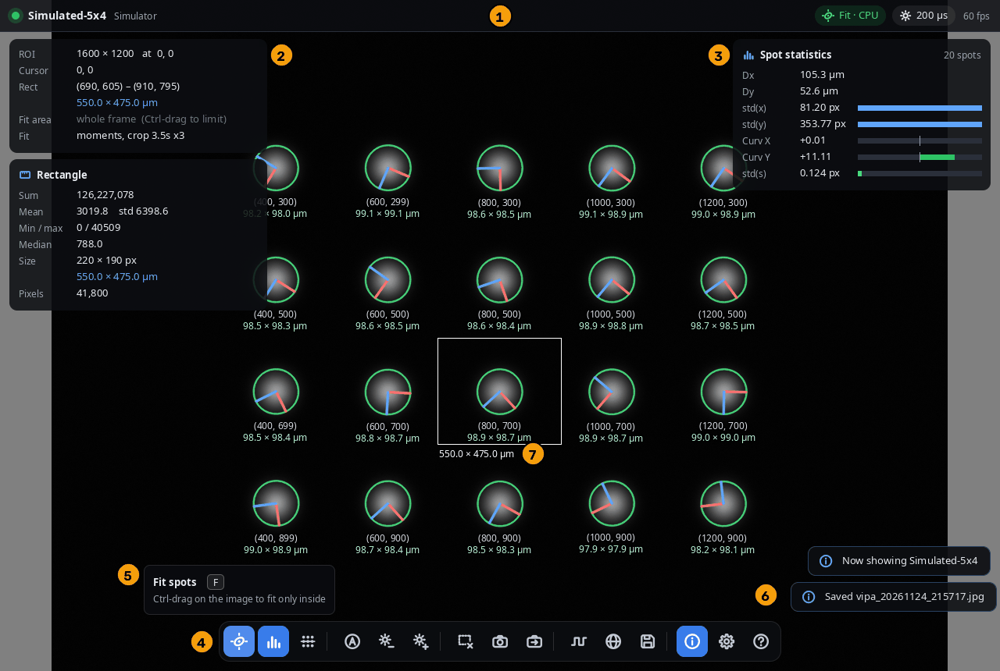
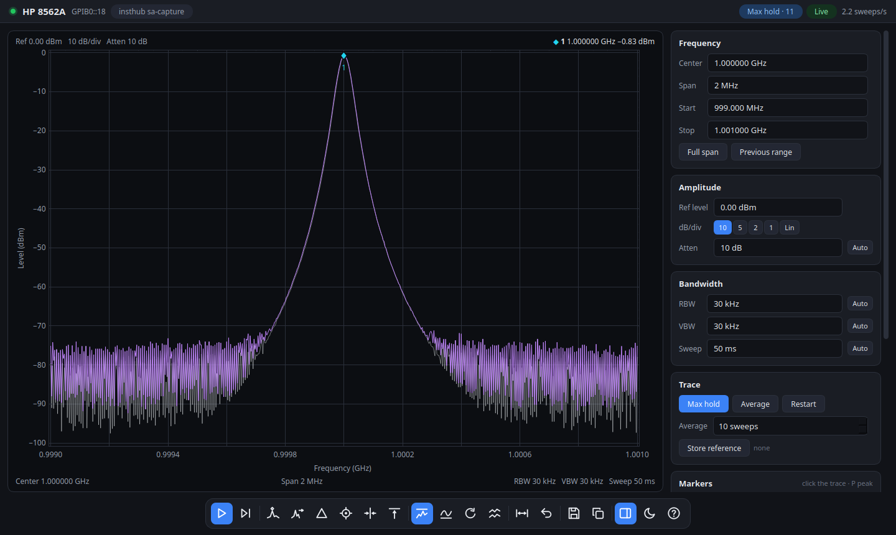

# Designing interfaces for experimental instruments

A guide for the programs that sit between a person and a lab instrument: a camera viewer, a spectrum
analyzer front end, a laser-lock panel, a DAQ display, a motion controller. It collects the rules that made
two such programs work, and the measurements behind them.

An instrument program works when it shows the measurement, never freezes, and never lies, whatever the
instrument is doing. Instruments differ a great deal: a camera delivers 60 frames a second, while an old
GPIB analyzer takes a second per sweep and silently rounds what you ask for. The rules here hold for both
kinds; where the right answer depends on the instrument, the guide says how to tell.

| Document | Covers |
|---|---|
| [interface.md](interface.md) | What the operator sees: layout, colour and themes, numbers, speed and feedback, keys and controls, hardware failure, settings, scale, scripting |
| [architecture.md](architecture.md) | The code underneath: layers, who owns the hardware, talking to slow instruments, the UI loop, device plugins, lifecycle, configuration, testing without hardware, deployment |

## The two worked examples

Each rule names where the examples do it, so you can read working code. Paths start at `~/Code`.

| | Basler Beam Profiler | HP 8562A spectrum analyzer GUI |
|---|---|---|
| Instrument | Industrial cameras (Basler, GenICam, Tucsen, UVC) | One HP 8562A on GPIB (NI GPIB-USB-HS, linux-gpib) |
| Pace | Streaming: 60 frames/s | Slow: 0.5-1.5 s per sweep, 70-100 ms per query |
| Toolkit | OpenCV window drawn by hand, Tk side windows | Qt (PyQt6) and pyqtgraph |
| Scripting | HTTP API, status file | The insthub instrument bus |
| Code | `Basler_Beam_Profiler/beam_profiler/` | `hp_8562a_gpib/` (`hp8562a_gui/`, `bus_server.py`, `hp8562a.py`) |

## The rules on one page

What the operator sees ([interface.md](interface.md)):

1. **The measurement is the interface.** Data fills the window; controls can be hidden.
2. **The window never waits for the instrument.** Its speed does not depend on the instrument's.
3. **State is always visible**: which device, whether it is live, what is switched on.
4. **Colour means state.** One accent means "on"; green, amber and red mean good, warning and error. The
   same meanings in a light and a dark palette.
5. **Numbers are honest.** Every number has a unit. Uncalibrated, rounded, stale or simulated values say so.
6. **Data describes itself.** Labels around the data come from the data's own settings, so a screenshot
   is a record.
7. **Every action has one name.** Keys, buttons, the help card and the scripting interface share it.
8. **Discoverable first, then fast.** Tooltips show the key; one key lists every key.
9. **Controls match the instrument's pace.** Continuous controls (wheel, drag) only for instruments that
   keep up; for slow ones, discrete actions with an instant preview.
10. **Devices come and go.** Unplugged, slow to open and not responding are normal states with their own
    screens.
11. **Every message says three things:** what happened, what the program is doing, what you can do.
12. **Tunables live in one registry**, which generates the settings window, the API and the file.
13. **Everything on screen is scriptable**, and changes made by scripts appear on screen.
14. **It runs without hardware.** A simulator stands in for the instrument.
15. **It scales**: one interface zoom, small windows, both palettes.

The code underneath ([architecture.md](architecture.md)):

1. **Dependencies point one way.** Drivers and analysis know nothing about the UI.
2. **One owner per instrument.** Other threads and programs post requests and read snapshots.
3. **Measure the instrument before designing for it**: the time of every operation, and what blocks.
4. **Prefer the instrument's non-blocking and compact paths**: a sweep that leaves the parser free, binary
   transfers, batched queries.
5. **Read back instead of assuming.** Instruments round and clamp silently.
6. **Each acquisition carries its settings**, so data and labels can never disagree.
7. **Device lifecycle is its own object**: opening, losing, reconnecting, restoring.
8. **Every tunable is declared once**; configs are immutable and swapped whole.
9. **Analysis is pure functions over arrays**, and fast paths are checked against a slow reference.
10. **Defaults are measurements**, and tests re-run them.
11. **Everything is testable without hardware**: a simulator at the byte level, devices that can be
    unplugged, headless UI tests.
12. **Watch the drawing cost.** In Qt, a plot line wider than 1 px can cost 500 times more to draw.
13. **Optional dependencies degrade; user files are handled gently; updates happen only at start-up.**

## Checklist for a new instrument program

- [ ] Data fills the window; controls are in panels that can be hidden and never cover data you need
- [ ] The UI thread never waits for the instrument; every command returns at once and reports later
- [ ] A change shows at once (preview, pending state), and requests made while one is on its way are merged
- [ ] Continuous controls only if the instrument follows them at about 10 Hz or faster
- [ ] Status bar: device, address, live or offline, mode, what is switched on, rate
- [ ] One palette module, a dark and a light palette with the same meanings; follows the desktop
- [ ] Every number has a unit; rounded, uncalibrated, stale and simulated values are flagged
- [ ] Labels around the data come from the data's own metadata
- [ ] Keys, buttons, help card and API come from one action table; every button has a key
- [ ] Unavailable actions are dimmed, not hidden; no dialog blocks the live view
- [ ] Unplug test: banner over the dimmed last data, automatic reconnect, settings kept or restored
- [ ] Failure is detected within seconds, however long one acquisition takes
- [ ] The instrument's timing is measured and written down; the driver uses its fastest paths
- [ ] Every value sent is read back; a value the instrument changed is announced
- [ ] A simulator exists; the program opens and the tests run with no hardware and no display
- [ ] Plot lines are 1 px (Qt); repaint time is measured with real data at full screen size
- [ ] All sizes go through one interface zoom; both palettes are tested
- [ ] Everything on screen is scriptable; raw data is saved next to every picture

## Keeping this guide current

When an app changes a rule described here, update the guide in the same change. Screenshots of the Beam
Profiler come from its simulator (`python -m beam_profiler --sim`, rendered headlessly through
`Viewer.step()`); those of the HP 8562A GUI from `hp_8562a_gpib/tools/gui_screenshots.py` (simulator) and
`--analyzer` (the real instrument).
