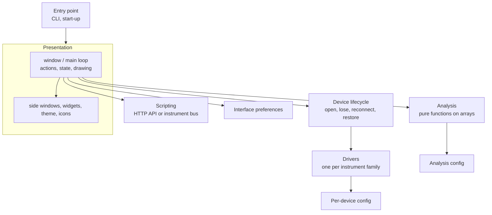

# Architecture for instrument programs

The code underneath the interface: how it is split up, who owns the hardware, how to talk to a slow or
quirky instrument, where configuration lives, and how it is tested without hardware. Worked examples: the
**Beam Profiler** (`Basler_Beam_Profiler/`, cameras, 60 frames/s, one process with a hand-written loop)
and the **HP 8562A GUI** (`hp_8562a_gpib/`, a GPIB analyzer at 0.5-1.5 s per sweep, Qt plus an insthub
device). [interface.md](interface.md) covers what the operator sees.

---

## 1. Layers and dependency direction

| Layer | May import | Must not import | Beam Profiler | HP 8562A GUI |
|---|---|---|---|---|
| Presentation | everything below | | `ui/` | `hp8562a_gui/window.py`, `widgets.py`, `theme.py`, `icons.py` |
| Scripting | analysis, config | the UI | `server.py`, `status.py` | `bus_server.py` (insthub device) |
| Device lifecycle | drivers, config | windows, toolkits | `cameras/session.py`, `manager.py` | insthub's device runtime + `bus_server.py` |
| Drivers | the vendor library (lazily) | UI, analysis | `cameras/<vendor>.py` | `hp8562a.py`, `hp8562a_sim.py` |
| Analysis | numpy | devices, UI | `processing/` | `hp8562a_gui/analysis.py`, `units.py` |
| Configuration | the standard library | the rest | `fitconfig.py`, `cameraconfig.py`, `uiconfig.py` | `hp8562a_gui/config.py` |

Why: the analysis runs on a bare array in a test or a notebook; a driver can be tested without its SDK;
the lifecycle logic can be tested without a window; and the driver can be used from a script with no GUI
at all (`python3 hp8562a.py --trace a.csv`).

---

## 2. One owner per instrument

Exactly one thread (or process) talks to an instrument. Everyone else reads snapshots and posts requests.

| Model | Who owns the device | When it fits | Example |
|---|---|---|---|
| Main loop | The UI loop itself, between frames | A fast device whose grab never blocks long; one program uses it | Beam Profiler: `Viewer.run()` grabs, analyses and draws, 60 fps |
| Device thread | A thread per device; requests queue to it | Slow devices; several clients; the UI must not wait | HP 8562A: the insthub device thread, in the window's process or in `bus_server.py` |
| Separate process | A server program; clients connect | Several programs at once; a vendor library that blocks or crashes | `bus_server.py` as a service; the GUI connects to it |

The rules that keep this safe:

- **Only the owner touches the device.** In the Beam Profiler the scanner thread only enumerates and a
  worker only opens; the Tk windows and the HTTP server read `manager.snapshot()` and post tuples that the
  main loop runs on the next frame. In the analyzer GUI every instrument operation is a command or a
  periodic task on the device thread; the window gets results through futures and streams.
- **Requests run in order, and none waits on the UI thread.** A command returns a future; its result comes
  back to the UI thread through the toolkit's event queue (`qt.deliver`).
- **Shared configuration is immutable and swapped whole**, and the few cross-thread writes are single
  assignments of immutable values.
- **Check that the vendor library releases Python's GIL.** If a C extension holds the GIL while it waits
  for the bus, a device thread freezes the UI thread in the same process. Measure it: run the library's
  slowest call in a loop in a thread and time `time.sleep(0.001)` in the main thread. For linux-gpib's
  `gpib` module the worst sleep stayed at 4.5 ms (3.8 ms idle) while serial polls ran, so the GIL is
  released and the analyzer server can live inside the window. If it is not released, put the device in
  its own process.

---

## 3. Measure the instrument first

Before writing the driver, time every operation you will use, find out which ones block, and write the
numbers down where the next developer will look. The HP 8562A, through an NI GPIB-USB-HS on linux-gpib:

| Operation | Time | Consequence |
|---|---|---|
| Read a 601-point trace in ASCII (`TDF P`) | 1983 ms | The instrument formats ASCII slowly |
| Read it in binary (`TDF B`, 1202 bytes) | 105 ms | Use binary: 19× faster; convert in software |
| One query (`CF?`) | 70-100 ms | Few round trips per sweep |
| Nine queries in one write, nine reads | about 600 ms | Batch the settings read; do it rarely |
| Serial poll | 30 ms | Cheap enough to poll every 30 ms |
| `TS` (take sweep), then `ID?` | `ID?` answered after 3068 ms | `TS` holds the command parser for the whole sweep (up to 100 s) |
| `SNGLS` (single sweep), then `ID?` | `ID?` answered after 74 ms | Starts a sweep and leaves the parser free |
| Settings change during a sweep | applies at once | Changes need not wait for the sweep |
| GPIB device clear | a full instrument preset | Never send it on open: it erased the settings and the trace |

Before these measurements one sweep took about 3.4 s and a settings change could wait up to 100 s behind
a sweep. Afterwards a live sweep takes 1.5 s at full span and 0.47 s at 10 MHz span (0.31 s of it the
instrument itself), and a change applies within about 1 s at any time.

---

## 4. Talking to a slow or quirky instrument

- **Use the non-blocking primitive.** The analyzer device starts each sweep with `SNGLS` and watches the
  end-of-sweep bit of the status byte (enabled with `RQS 4`) by serial poll every 30 ms, between other
  commands. A command that blocks the instrument (`TS`) would block every other request too.
- **Use the compact transfer.** Binary trace data, converted with the instrument's documented scaling
  (`level = RL + (mu − 600) × dB/div / 60`), checked against the ASCII values (they agree to 0.007 dB, the
  ASCII rounding). Keep a fallback for modes where the scaling was not checked (linear scale uses ASCII).
- **Batch queries; read settings rarely.** One write with all queries, one read per reply. The analyzer
  reads settings at connect, after every change, and every 5 s while sweeping (to catch front-panel
  changes), overlapping the sweep so it costs no sweep time.
- **Read back instead of assuming.** After every change, read what the instrument actually set and return
  that to the caller (`configure()` returns the settings). Instruments clamp and round silently.
- **Each acquisition carries its settings.** Every published trace frame has its start, stop, reference
  level, scale, units, bandwidths and sweep time in its metadata. Displays and files use those, so data
  and labels cannot disagree, and a change made by another client shows up correctly.
- **Publish progress for long acquisitions** (partial frames with a progress fraction, and a flag when the
  unswept part still holds data from older settings), and only complete ones for averaging.
- **Detect a dead link quickly.** Short timeouts for polls (3 s), long ones only where needed. A timeout
  drops the session and the next request reopens it; the instrument keeps its settings, so the reopen must
  not reset them.
- **Write the traps down next to the code**: in the driver's docstrings and the README (device clear =
  preset; `TS` blocks; silent clamping; which firmware needs which option module).

---

## 5. The UI loop

- **The loop is one function that touches no window, or it is the toolkit's event loop with nothing
  slow in it.** The Beam Profiler's `step()` services device events, grabs, processes and composes the next
  picture; `run()` shows it and handles keys. The analyzer GUI is event driven: timers poll the
  subscriptions (`qt.watch`), a 150 ms tick updates readouts, the status bar and the health display, and a
  30 fps timer redraws only when something changed.
- **Catch exceptions per frame or per slot, never per call site.** Log with a traceback at most once per
  10 s per kind, show a toast, and carry on. Only the operator ends the program.
- **Keys and buttons call one function by name** (`_act(name)`, `act(name)`), so tests press buttons.
- **Keep drawing cheap** (see [interface.md](interface.md#5-speed-and-feedback)): render once and blend
  (the Beam Profiler caches every text, icon, card and toolbar as a sprite keyed by content and scale);
  batch per-item graphics (one `polylines` call per colour); resize before converting; in Qt plots, use
  1 px lines and measure a repaint at full screen size with real data.

---

## 6. Devices as plugins, and as bus servers

- **A device family is a plugin behind a small interface.** The Beam Profiler's `Backend` (enumerate, open,
  availability, install hint) and `Camera` (grab, cached getters, `close()` that never raises). A missing
  SDK disables that one backend and says how to install it.
- **Identity survives a replug** (`backend:serial`), so state can be restored.
- **Getters answer from cache**, and keep answering after an unplug, so the state can be saved.
- **One exception means "gone"** (`CameraDisconnected`); every other driver error is a missed frame,
  counted and rate-limited.
- **An instrument bus makes the device a server.** The analyzer's driver (`HP8562A`) is wrapped in an
  insthub `Device` that adds modes (live, single, hold, free), the acquisition loop, `configure()` and
  `settings()`, and publishes the stream `trace`. The same server runs inside the GUI or alone as
  `bus_server.py`, and the GUI uses whichever is there.
- **Adding a family is one module plus a registry line**; adding an instrument to the bus is one small
  server file in the instrument's own project (see insthub's *who sets up what*).

---

## 7. Device lifecycle

Split the work between three objects. Most of the logic sits in the middle one, which has no UI code.

| Object | Question | Beam Profiler | HP 8562A GUI |
|---|---|---|---|
| Inventory | Which devices exist? | `CameraManager` (scan thread, six states, events) | One analyzer at a configured address |
| Session | Which device is in use, and what happens when it changes? | `CameraSession`: lose, reconnect, switch, restore, start-up fallback | insthub's device runtime: open, link errors, reopen; `bus_server.SpectrumAnalyzer.open()` re-arms the sweep flag |
| View | What does the operator see? | `Viewer`: per-camera state as a dict, three callbacks | `MainWindow`: state stream, health display, banner |

- **One missed scan is not an unplug**; a failed open is retried after a pause.
- **Losing a device**: save its state, close the handle, go offline, wait. **Getting it back**: reopen on a
  worker, restore, resume. The analyzer keeps its own settings; the program only has to resume its mode.
- **Start-up never waits** for a slow device (2 s at most, then the window opens and the device joins).

---

## 8. Configuration

- **Every tunable is declared once**, as a frozen dataclass plus a tuple of metadata (name, label, type,
  range, group, help). The settings window, the API and the file come from it, and a test checks the two
  cannot drift apart (`fitconfig.SETTINGS`).
- **Per-model differences are data, not code** (`camera_config.yaml`, resolved defaults → globs → model →
  serial). An unlisted model works; a missing calibration is flagged, never guessed.
- **Each file has one owner module**, loading forgives bad values field by field, saving keeps comments
  in hand-edited files and refuses to write anything but the intended change.
- **Interface preferences are separate** (zoom, palette, window size, panel): `ui_config.json`,
  `~/.config/hp8562a-gui.json`, with an environment variable to point tests elsewhere.

---

## 9. Analysis code

- **Pure functions over arrays, no device, no UI** (`processing/`; the analyzer's `analysis.py` for
  peaks, max hold and averaging, and `units.py` for parsing and formatting).
- **Results are columns, not objects**; JSON is built only when someone asks.
- **One estimator, a reference and its fast paths**, checked against each other (the Beam Profiler's
  scalar, batched and CUDA fits agree to 1e-9).
- **Defaults are measurements**, and tests re-run the measurements.
- **Document the units where a reader would trip**: 2 × σ widths; averaging on power, not dB.

---

## 10. Testing without hardware

Everything is testable with no instrument, no GPU and no display; the few tests that need one skip
themselves.

| What | How | Beam Profiler | HP 8562A |
|---|---|---|---|
| Analysis | Synthetic data with known answers | `test_processing.py` | `test_units_and_analysis.py` |
| The driver | A simulator below the driver | pylon's camera emulator | `hp8562a_sim.py`: the real driver over a model that parses the same commands |
| Hot-plug, failures | Fake devices that can be unplugged mid-call | `FakeBackend`, `FakeCamera` | `model.unplugged = True` in the simulator |
| The device server | In-process, sped up | | `test_driver_and_device.py`: modes, partial sweeps, changes mid-sweep, unplug and recover |
| The UI | Headless (`Viewer.step()`, Qt `offscreen`) | `test_ui.py` | `test_gui.py`: actions by name, markers, zoom, undo, toasts, saving, banner, palettes, pen widths |
| Screenshots | The same headless path | docs images | `tools/gui_screenshots.py` |

- **Simulate at the lowest level you can.** A simulator that replaces the driver tests the UI; one that
  replaces the bytes tests the driver too. The analyzer's simulator answers `FA?;FB?;...` batches, binary
  `TRA?`, serial polls and `ERR?`, rounds and clamps like the instrument, blocks on `TS` and not on
  `SNGLS`. Every simulator rule is one measured on the instrument.
- **The simulator is a product feature**: `--sim` runs the whole program for demos and development, and
  its data is labelled simulated everywhere.
- **Make time and threads deterministic** in tests: disable scan threads, pass clocks, speed the
  simulator up (`speed=5`).
- **Tests never touch the user's files**: fixtures point every config file at a temporary path.
- **Test names are sentences**: `test_a_settings_change_takes_effect_during_a_sweep`,
  `test_every_plot_line_is_one_pixel_wide_so_repaints_stay_fast`. The list reads as a specification.
- **Test on the real instrument too**, before calling it done, and write down what was and was not tried.

---

## 11. Robustness

- **Nothing a device does ends the program.** Per-frame and per-slot exceptions are caught; a lost device
  goes offline; every hardware call goes through a guard or the device thread.
- **`close()` never raises**, even on a device that is gone, and leaves the instrument usable from its front
  panel (the analyzer server returns it to continuous sweep and local control).
- **Rate-limit repeating log lines.** The first failure is the one that matters.
- **Errors carry the remedy**: an install hint, the address that did not answer, *run setup_gpib.sh*.
- **Validate at the boundary**: clamp config values, check API input, refuse unknown setting names.

---

## 12. Optional dependencies, platforms, deployment

- **Optional dependencies degrade with a log line**: a missing camera SDK disables one backend; no Pillow
  falls back to Hershey text; no `gpib` module still runs the simulator.
- **Keep each platform quirk in one module** (`ui/desktop.py` for X11 and Qt workarounds).
- **Ship no asset files you can generate**: icons drawn in code, the app icon embedded.
- **Servers run as services; windows run from launchers.** An instrument server with no window can run as
  a background service (`insthub service install bus.toml`: starts at login, restarts on failure, keeps
  logs). A program with a window belongs to the desktop session and starts from a launcher.
- **Updates happen only at start-up**, never under a running copy and never over local changes (the Beam
  Profiler's self-updater).

---

## 13. Documentation as part of the code

- **Module docstrings explain why, with numbers**: why one CUDA launch beats array operations; why plot
  lines are 1 px (1.1 s against 2.3 ms per repaint); why the driver never sends `TS`.
- **Record the traps where the next developer will look**: a *conventions that bite* list in `CLAUDE.md`,
  the instrument's traps in the driver and the README.
- **One user document per domain**, and this guide for the patterns they share.

---

## 14. Checklist

- [ ] Analysis and drivers import nothing from the UI; the driver works from a plain script
- [ ] One owner per instrument; others post requests and read snapshots; the UI thread never waits
- [ ] The vendor library is checked for holding the GIL; if it does, the device runs in its own process
- [ ] Every instrument operation is timed and written down; blocking operations are known
- [ ] The driver uses non-blocking acquisition, compact transfers and batched queries where they exist
- [ ] Every change is read back; acquisitions carry the settings they were taken with
- [ ] A dead link is detected within seconds; reopening never resets the instrument
- [ ] Device lifecycle lives in a UI-free object; identity survives a replug
- [ ] Tunables in one registry; configs frozen and swapped whole; per-model data, not code
- [ ] Analysis is pure and columnar; fast paths match a reference; defaults are measured
- [ ] A byte-level simulator, unpluggable fakes, headless UI tests and a screenshot tool exist
- [ ] Tests are isolated from user files; test names are sentences; the real instrument was tried too
- [ ] `close()` never raises and leaves the front panel usable; logs are rate-limited
- [ ] Optional dependencies degrade; servers run as services, windows from launchers
- [ ] The traps and the numbers are written next to the code

---

## Appendix: where each pattern lives

| Pattern | Beam Profiler (`Basler_Beam_Profiler/`) | HP 8562A (`hp_8562a_gpib/`) |
|---|---|---|
| Entry point | `beam_profiler/__main__.py` | `hp8562a_gui/__main__.py` (connect to a server or host one) |
| Driver | `beam_profiler/cameras/basler.py` etc. | `hp8562a.py` |
| Simulator | `beam_profiler/cameras/simulated.py`, `synthetic.py` | `hp8562a_sim.py` |
| Lifecycle | `beam_profiler/cameras/session.py`, `manager.py` | insthub + `bus_server.py` |
| Acquisition loop | `Viewer.step()` | `SpectrumAnalyzer._acquire_step()` in `bus_server.py` |
| Main window | `beam_profiler/ui/viewer.py` | `hp8562a_gui/window.py` |
| Configuration | `fitconfig.py`, `cameraconfig.py`, `uiconfig.py` | `hp8562a_gui/config.py` |
| Analysis | `beam_profiler/processing/` | `hp8562a_gui/analysis.py`, `units.py` |
| Tests | `tests/` (276 tests) | `tests/` (55 tests) |
| Measurements written down | `docs/fitting-calibration.md` | `docs/gui.md` (*How sweeps are taken*, *Keeping the window fast*) |
