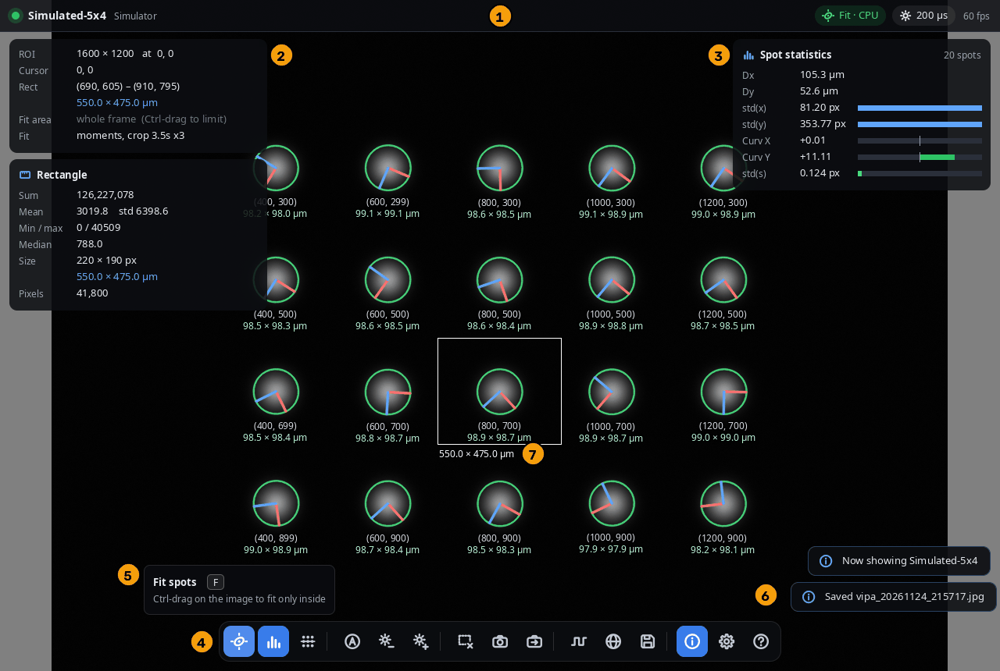
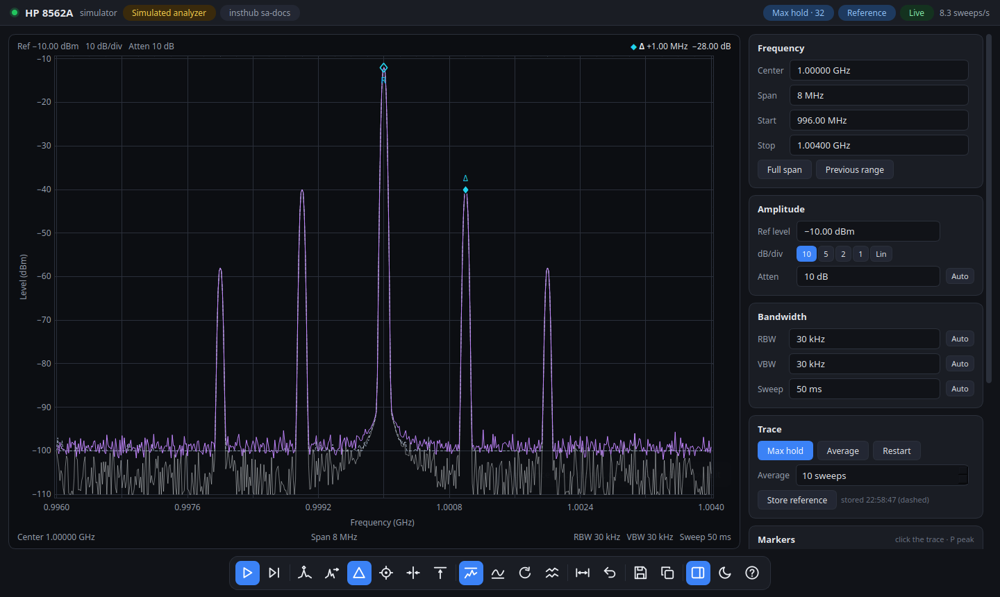
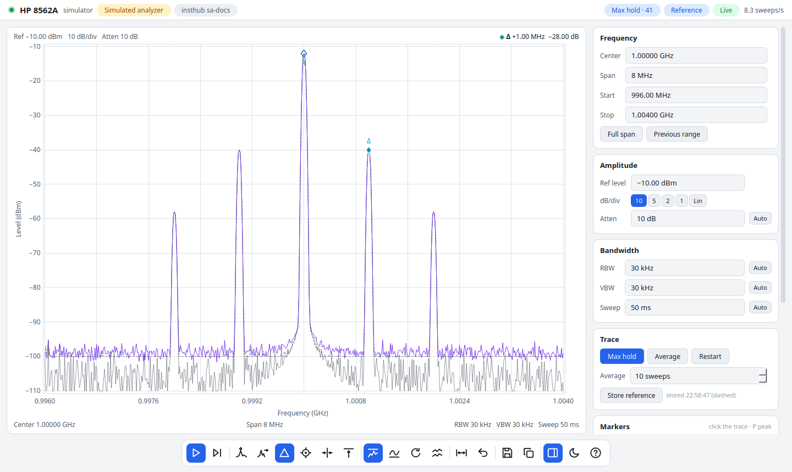
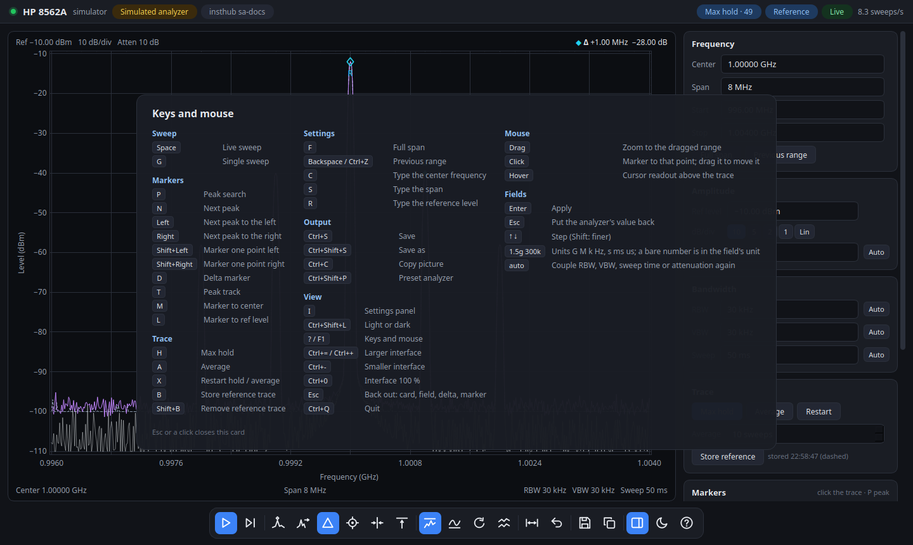
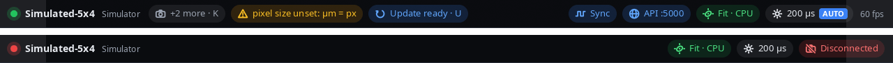
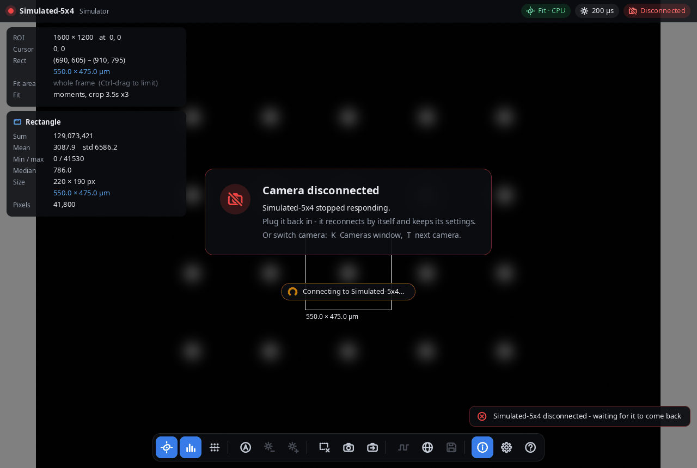
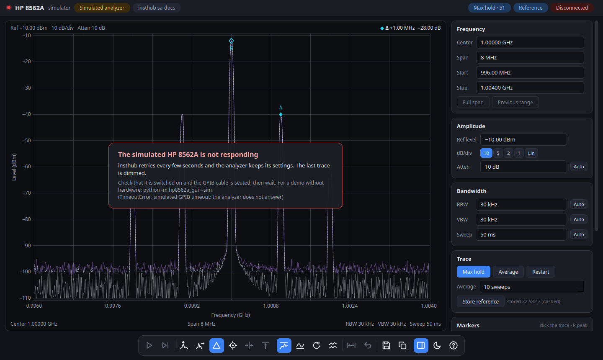
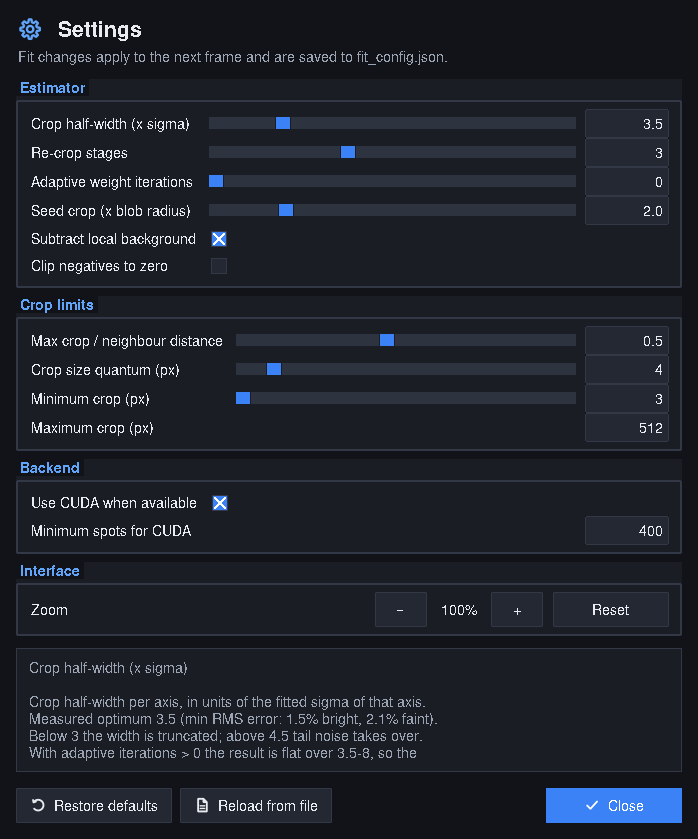
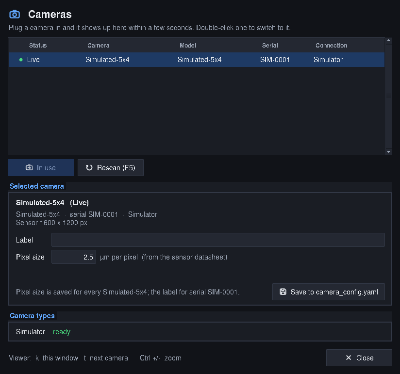
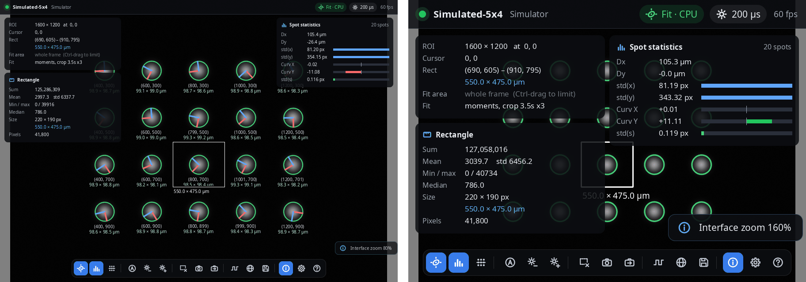

# Interface design for instrument programs

What the operator sees, and why. Each rule says what to do, why, and where the two worked examples do it:
the **Beam Profiler** (`Basler_Beam_Profiler/`, a streaming camera viewer) and the **HP 8562A GUI**
(`hp_8562a_gpib/`, a front end for a slow GPIB spectrum analyzer). [architecture.md](architecture.md)
covers the code underneath.

---

## 1. First, know your instrument's pace

Most decisions in this guide depend on one number: how long the instrument takes to answer. Measure it
before you design anything (see [architecture.md](architecture.md#3-measure-the-instrument-first)).

| | Streaming | Slow, polled | Actuator |
|---|---|---|---|
| Examples | Cameras, fast scopes, DAQ cards | GPIB/serial analyzers, lock-ins, DMMs, old scopes | Stages, power supplies, lasers, shutters |
| Data rate | 10-100 updates/s | 0.1-5 updates/s; one query 30-100 ms | Position or state readback, 1-10 Hz |
| A settings change | Applies on the next frame | Costs a command, a read-back and often a new sweep (0.5-1.5 s) | Starts a motion that takes time |
| "Live" means | The newest frame, now | The newest complete sweep, with its age | Where it is now, where it is going |
| Fitting controls | Continuous: wheel, drag, sliders | Discrete: typed values, steps, one gesture, with a preview | Discrete targets plus a stop button |
| Failure shows as | Frames stop | A query times out | Readback stops or disagrees with the target |

The Beam Profiler is streaming: the mouse wheel zooms the camera's ROI and the result is on screen in the
next frame. The HP 8562A is slow: the same wheel zoom made each notch cost a settings change and a new
sweep, the picture lagged behind the hand, and it was removed (section 5).

---

## 2. Layout: the data is the interface

- **Fill the window with the data.** The picture or trace takes all the space it can, in a freely
  resizable window whose size is remembered and clamped to the screen.
- **Controls float or dock, but never sit in front of data you need.** Choose by the shape of the data:
  - An image with margins (a beam on a sensor): float translucent cards over the edges. The Beam
    Profiler's cards sit in the top corners and the toolbar along the bottom, over the dark border.
  - A trace that spans the full width (a spectrum, a time series): dock the panel beside it. The HP 8562A
    GUI keeps its settings panel on the right, because a card over a spectrum covers data.
  - Either way every panel can be hidden (`I` in both apps) to give the space back to the data.
- **Give each role a fixed place.** The operator learns where to look once:

| Place | Role | Beam Profiler | HP 8562A GUI |
|---|---|---|---|
| Top bar | State: device, connection, mode, features | Camera, fps, exposure, feature chips | Analyzer, address, chips for simulated, over range, trace mode, live |
| Next to the data | What the view shows | Left cards: ROI, cursor, rectangle | Annotations above and below the trace: ref level, scale, span, RBW, sweep time |
| Opposite side | What the analysis found | Right cards: spot statistics | Marker readout above the trace; marker and peak list in the panel |
| Bottom centre | Actions | Icon toolbar | Icon dock |
| Centre | A problem that blocks the data, or the help card | Banner | Banner |
| Corner | Brief messages | Toasts, bottom right | Toasts, bottom right of the trace |

- **Draw overlays in display space.** Text and line widths stay the same when the data is zoomed. Keep the
  coordinate systems apart (sensor, ROI and display pixels in the Beam Profiler; frequency and screen in
  the analyzer) and convert in one place.
- **Store geometry in hardware units.** A rectangle in sensor pixels, a marker in hertz: they survive zoom,
  ROI and span changes and reconnects. The analyzer's marker stays on its frequency when the span changes,
  and says *off screen* when it is outside the range.
- **Keep watching apart from setting.** What you watch while aligning stays in the main window; what you
  set once (fit parameters, a camera's pixel size) goes in side windows that never block it.

---

## 3. Visual language

**One palette module defines every colour,** and nothing else does (`beam_profiler/ui/theme.py`,
`hp8562a_gui/theme.py`). Colours are tokens with meanings:

| Token | Dark | Light | Meaning |
|---|---|---|---|
| `BG` | `#111318` | `#f3f4f6` | Window background |
| `SURFACE` | `#1a1d24` | `#ffffff` | Cards, fields |
| `TEXT` / `SUBTEXT` / `MUTED` | `#e8ebf0` / `#9aa3b2` / `#6b7383` | `#151922` / `#4a5263` / `#8a92a0` | Values / labels / hints and disabled |
| `ACCENT` | `#3b82f6` | `#2563eb` | On, selected, active: the only decorative colour |
| `GOOD` | `#22c55e` | `#16a34a` | Live, ready |
| `WARN` | `#f59e0b` | `#d97706` | Needs attention, in progress, simulated, uncalibrated |
| `BAD` | `#ef4444` | `#dc2626` | Error, disconnected |

- **Colour means state, and only state.** Green, amber and red never decorate. Each state colour has a
  text variant that stays readable on a card in its palette (`GOOD_TEXT` and so on).
- **Measurement graphics have their own colours,** documented and separate from the chrome, so a colour in
  the data never reads as a state: the Beam Profiler's fitted ellipses and axes; the analyzer's live trace,
  max hold (violet), average (pink), reference (grey, dashed) and markers (cyan).
- **The data has the most contrast.** On a dark background the live trace is near-white; on a light one,
  near-black. Held, averaged and reference traces are coloured but quieter; a stale trace is faded.
- **Two palettes, the same meanings.** Follow the desktop's light or dark setting by default, let the
  operator choose (the analyzer: Ctrl+Shift+L cycles desktop, dark, light), and remember the choice with
  the interface preferences. Switching re-applies every colour, including the plot, the icons and the
  toolkit's own palette, so system dialogs (Save As) match. Test both palettes; a light palette needs its
  own data colours, not the dark ones.

 

- **Flat, and quiet labels.** No gradients or shadows. Labels are smaller and in `SUBTEXT`; values are in
  `TEXT`, so the eye lands on the number.
- **Anything drawn on a picture reads over bright and dark areas**: text with a dark halo, rectangles as
  a thin line over a dark outline (Beam Profiler).
- **Icons are drawn in code**: line icons on a 24-unit grid with a 2-unit stroke, rendered fresh for each
  size and palette, so nothing blurs at a zoom and no image files ship (both apps).

---

## 4. Numbers

- **Every number carries its unit.** `−12.00 dBm`, `300 kHz`, `550.0 × 475.0 µm`. Use a real minus sign
  (−) so columns line up.
- **Flag what is not what it seems.** A missing calibration falls back visibly: the Beam Profiler shows an
  amber `pixel size unset: µm = px` chip and reports `pixel_size_known: false` to scripts. Simulated data
  gets an amber `Simulated analyzer` chip, the word *simulated* in the window title, and `SIMULATED` in
  every saved file. A wrong value that looks right is the worst kind.
- **Announce what the instrument changed.** Instruments round and clamp without an error: the HP 8562A
  turns RBW 200 kHz into 300 kHz and center 50 GHz into 22 GHz, and its error queue stays empty. Read the
  value back after every change and, if it differs, say so: *RBW is 300 kHz: the analyzer's nearest to the
  200 kHz asked*. Then show the instrument's value, never the one you asked for.
- **Labels describe the data on screen.** The analyzer's annotations (ref level, span, RBW, sweep time)
  come from the trace's own metadata, not from the current settings; the panel shows the current
  settings. The two differ only while a change is on its way, and a screenshot is always a correct record.
- **Digits follow the resolution, but never hide what was typed.** Show a frequency to about one display
  point (span/600), but if the value has more digits, show them: a typed 1.0000123 GHz is not displayed as
  1.00001 GHz.
- **Refresh digits slowly enough to read** (7 Hz or less): the Beam Profiler latches values for 0.15 s; the
  analyzer updates readouts on a 150 ms tick. Graphics still move at full rate.
- **Smooth noisy statistics before showing them**, and say how (the Beam Profiler's moving average of the
  spacing scatter; the analyzer's averaging says *on power*, because power and dB averages differ by 2.5
  dB on noise).
- **Put a gauge next to a number** to show its size at a glance; centred for signed quantities.
- **Give coordinates in hardware units**, so they can be typed into another tool or a script.
- **Save the raw data with every picture.** The Beam Profiler writes the displayed JPEG and the raw frame
  (`.npy`); the analyzer writes a PNG and a CSV with every setting in its header. A screenshot is not data.

---

## 5. Speed and feedback

The instrument may be slow; the window must not be.

- **Never wait for the instrument on the UI thread.** Every command returns at once and delivers its result
  later (the analyzer: insthub futures handed to the UI thread with `qt.deliver`); data arrives on
  subscriptions polled by a UI timer. One slow query on the UI thread freezes the window for its full
  duration, and a timeout freezes it for seconds.
- **Show the change at once, then confirm it.** When the operator asks for a new range, the plot shows the
  new range immediately with the old trace at its true frequencies, dimmed, and the field turns amber;
  when the new sweep arrives it replaces both. A small pill says what is being set (*Setting RBW…*).
- **One request in flight; merge the rest.** Requests made while one is on its way are merged into the next
  (the last value of each setting wins), so ten arrow presses become one or two instrument commands.
- **Match the controls to the instrument's pace.** A continuous control (wheel zoom, a dragged slider) is
  right when the instrument follows at about 10 Hz or faster: the Beam Profiler's wheel zooms the camera
  ROI, live. It is wrong when each step costs a second: the analyzer has no wheel zoom and no wheel
  stepping in fields. Zooming there is one gesture (drag a range) or one typed value.
- **Show long acquisitions as they build up.** A 5-100 s sweep is drawn as it progresses: the swept part
  bright, the rest dim, a dotted line at the sweep position, and the progress in the status bar (*sweep
  3.2 / 10 s*). Only complete acquisitions go into averages and max hold.
- **Keep drawing cheap, and measure it at full size with real data.** In Qt with antialiasing, a plot line
  wider than 1 px is stroked as a polygon. On the analyzer's zigzag noise floor at 2400 × 1300, one repaint
  took **1.1 s** with a 1.4 px pen, 0.39 s with a 2 px cosmetic pen, and **2.3 ms** with a 1 px pen. Every
  mouse move (a cursor line), toast and hover repaints the plot, so a wide pen made the whole window lag.
  Use 1 px lines and make the important trace stand out by contrast; check it in a test.
- **Redraw only when something changed**, at a capped rate (the analyzer: 30 fps when dirty; the Beam
  Profiler: one composed frame per loop, 60 fps cap, sprites cached).

---

## 6. Interaction

- **Keep one action table.** Keys and toolbar buttons call the same action by name (`Viewer._act(name)`;
  the analyzer's `ACTIONS` list becomes `QAction`s shared by keys, dock buttons and panel buttons). The
  tooltips and the help card are generated from it, and tests trigger actions by name.
- **Give every button a single-key shortcut.** At the optical table one hand is often on a mount.
- **Make the shortcuts easy to find:** a tooltip after 0.3 s with the name, the key as a keycap and a hint;
  `?` or F1 for a card with every key, grouped; empty places that say how to fill them (*Rect: drag on the
  image*, *Click the trace for a marker · P peak*).
- **Show state on the control itself.** An active feature's button is filled with the accent. A button
  that would do nothing now is dimmed, not hidden: Save while offline, Marker to center without a marker.
- **Let Esc back out one layer at a time**: the help card, then a delta marker, then the marker, then the
  field. Quitting needs Ctrl+Q or the close button (the Beam Profiler quits on the last Esc).
- **Use a modifier for a variant** instead of a new button: Shift-click on exposure steps ×10, Shift+Ctrl+S
  is Save As, Ctrl-drag draws the fit area, Shift+arrow moves a marker by one point.
- **Let the mouse act on the data:** drag a rectangle or a zoom range, click a marker, drag the marker.
  Keep the interface zoom on separate keys, so the two zooms are never confused.
- **Fields take numbers with units.** `1.5 GHz`, `1.5g`, `300k`, `50 ms`, `auto`; a bare number is in the
  unit the field shows. Enter applies, Esc puts the instrument's value back, arrows step through the
  instrument's own sequence (1-2-5 spans, 1-3-10 bandwidths). An unreadable entry turns the field red and
  says what is expected.
- **Never block the live view with a dialog.** Side windows are non-modal; a Save As dialog runs while the
  data keeps updating.

---

## 7. Hardware state and failure

Each situation has exactly one visual form:

| Situation | Form | Examples |
|---|---|---|
| Ongoing state | Status-bar dot and chips | Green dot = live; red dot and `Disconnected`; `+2 more · K` other cameras; `Paused · analyzer free-runs` |
| A problem that blocks the data | Centred banner over the dimmed last data | Camera unplugged; analyzer not responding; bus server gone |
| Something in progress | A pill with a spinner, data still visible | *Connecting to …*; *Setting RBW…* |
| A one-off result or error | Toast, 6 s, at most 4 | *Saved …*; a rounded value; a failed request |

 

- **Every message says three things**: what happened (*the HP 8562A at GPIB0::18 is not responding*), what
  the program is doing (*insthub retries every few seconds and the analyzer keeps its settings*), and what
  you can do (*check that it is switched on and the GPIB cable is seated*).
- **Dim the last data; never pass it off as live.** It stays on screen, faded, under the banner, and the
  scripting interface stops serving it as current.
- **Detect failure within seconds, however long one acquisition is.** The analyzer watches the end of each
  sweep by serial poll, which times out in 3 s on a silent instrument, so a 100 s sweep does not hide a
  dead analyzer for 100 s. A timeout is not a disconnect by itself: the Beam Profiler asks the camera's own
  "removed" flag or waits for repeated failures.
- **Restore everything on reconnect.** The Beam Profiler saves ROI, exposure, gain, rectangles and toggles
  per camera; the analyzer keeps its own settings, so the program must not reset them (a GPIB device
  clear is a full preset on the 8562A, and opening the session used to send one).
- **Start fast.** Open the window before a slow device is ready: the Beam Profiler shows the simulator for
  up to 2 s while a slow camera opens behind it; the analyzer window opens at once with a *Connecting* pill.
- **Treat unknown devices as normal**, and say what is missing and how to fix it (install hints for absent
  SDKs; *run setup_gpib.sh, or start with --sim*).
- **Share the bus politely.** When another program already uses the instrument's name on a shared bus, do
  not talk to the wrong device: the analyzer GUI checks that a device called `sa` has the analyzer's
  commands, and if not, serves the analyzer under another name and says so.

---

## 8. Settings and configuration

 

- **Keep one registry per domain.** Each tunable is declared once with name, label, type, range, group
  and help text; the settings window, the scripting interface and the config file come from it.
- **Generate the settings window from the registry**: sliders for small ranges, entry boxes for wide ones,
  checkboxes, grouped into cards, help text on hover.
- **Make the defaults measured, not guessed**, and quote the measurement in the help text.
- **Apply changes atomically.** Build a new immutable config and swap it in, so no frame sees half a change.
- **Say where a change is saved, and for what**, and offer *Restore defaults* and *Reload from file*.
- **Load config forgivingly.** A bad value is logged and replaced field by field, never a crash. Keep the
  comments in hand-edited files.
- **Let the instrument own its settings.** If the instrument stores its settings (the analyzer does), the
  program reads them, shows them and changes them; it does not keep a second copy that can drift.
- **Keep interface preferences apart** from measurement settings: zoom, palette, window size and panel
  visibility go in their own file (`ui_config.json`, `~/.config/hp8562a-gui.json`).

---

## 9. Scale

- **Use one interface zoom for everything** (50-250 %), saved. It sizes every font, padding, icon and
  line in every window; the code has no raw pixel sizes (`m.px(40)`, `m.font(13)`).
- **Re-render instead of resampling.** Cached text and icons have the scale in their key.
- **Shrink to fit.** A widget that would not fit the window at the chosen zoom shrinks itself; card
  columns stack in a narrow window; nothing falls off the screen.
- **Confirm each change** with a toast: *Interface zoom 160 %*.
- **Check a 4K screen.** Sizes, drawing cost and line widths all change with the pixel count (section 5).

---

## 10. Scriptability

- **Put everything on screen behind a scripting interface.** The Beam Profiler has an HTTP API (status,
  cameras, spots, rectangles, fit config, images) and mirrors its state to a JSON file. The analyzer is a
  device on an instrument bus (insthub): `insthub call sa configure span=10e6`, `insthub.device("sa")`
  from a script, a live stream of sweeps with their settings, all while the window is open.
- **Give scripts and screen one source.** The numbers a script gets are computed by the same function
  that fills the screen.
- **Changes flow both ways.** A rectangle set over the API is drawn; a span set from the command line
  appears in the analyzer window's panel and plot, because every sweep carries its settings.
- **Make errors specific**: `No rectangle defined`, `unknown settings: [...]`, the instrument's own error
  code; never a stack trace.

---

## 11. Checklist

See the [README](README.md#checklist-for-a-new-instrument-program).

---

## Appendix: where each pattern lives

| Pattern | Beam Profiler (`Basler_Beam_Profiler/beam_profiler/`) | HP 8562A GUI (`hp_8562a_gpib/`) |
|---|---|---|
| Main loop or window, action table, keys, mouse | `ui/viewer.py` | `hp8562a_gui/window.py` |
| Status bar, cards, toolbar, tooltips, help card, banner, pill, toasts | `ui/overlays.py` | `hp8562a_gui/widgets.py` |
| Palette and style | `ui/theme.py` | `hp8562a_gui/theme.py` (dark and light) |
| Icons drawn in code | `ui/icons.py` | `hp8562a_gui/icons.py` |
| Interface preferences | `uiconfig.py` | `hp8562a_gui/config.py` |
| Settings window from a registry | `ui/settings.py`, `fitconfig.py` | (the analyzer holds its settings) |
| Units, parsing, number formats | overlays and processing code | `hp8562a_gui/units.py` |
| Hot-plug, offline, reconnect | `cameras/session.py`, `cameras/manager.py` | insthub, `bus_server.py`, `window.py` (`_update_health`) |
| Scripting | `server.py`, `status.py` | `bus_server.py` on insthub |
| Headless UI tests and screenshots | `tests/test_ui.py` | `tests/test_gui.py`, `tools/gui_screenshots.py` |
